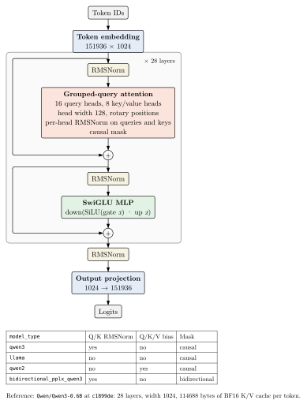
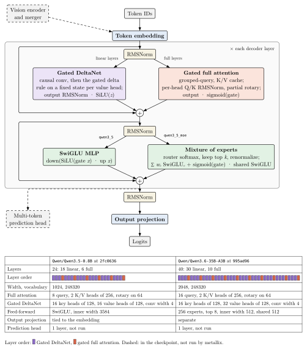
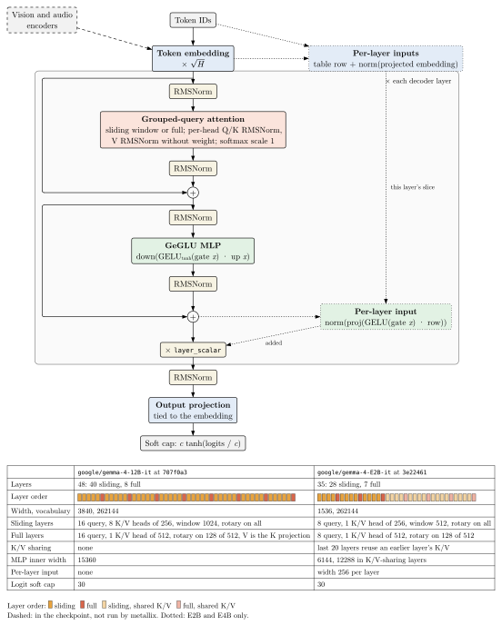
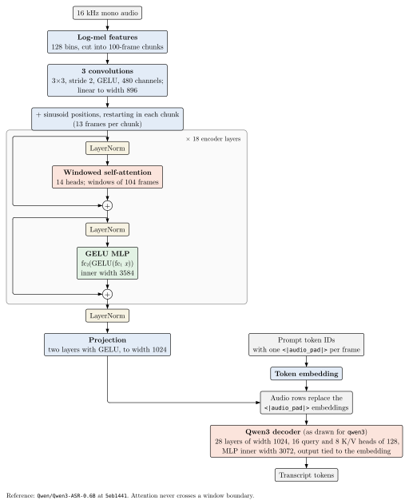
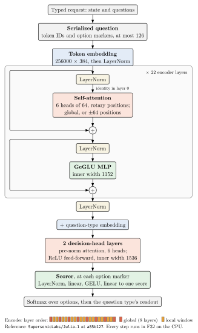
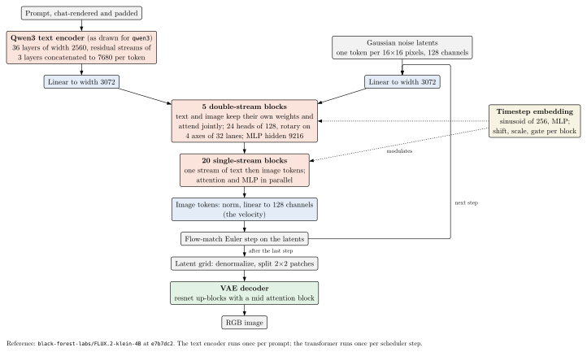
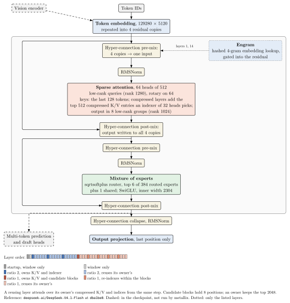

# Model architecture diagrams

One diagram per model architecture metallix runs. Each draws the blocks the
crate executes, with numbers from one or two reference checkpoints. A block
the checkpoint has but metallix does not run is drawn dashed; a block only
some checkpoints of the architecture have is drawn dotted.

## Dense decoder (`qwen3`, `llama`, `qwen2`, `bidirectional_pplx_qwen3`)

The dense decoder in `crates/models/qwen`, drawn at Qwen3-0.6B. Each layer
normalizes its input, applies grouped-query attention with rotary positions,
adds the result to the residual stream, then does the same with a SwiGLU MLP.
The table lists how the four model types this decoder accepts differ: Qwen3
normalizes each query and key head, Qwen2 adds a bias to the query, key and
value projections, and pplx-embed attends in both directions.

## Hybrid decoder (`qwen3_5`, `qwen3_5_moe`)

The decoder in `crates/models/qwen35`, drawn at Qwen3.5-0.8B (dense) and
Qwen3.6-35B-A3B (mixture of experts). Three of every four layers mix tokens
with Gated DeltaNet, whose state per sequence has a fixed size; the fourth is
full attention with a K/V cache and a sigmoid output gate. The dense
checkpoints use a SwiGLU MLP; the mixture-of-experts ones route each token to
its top experts and add a gated shared expert. The vision tower and the
multi-token prediction head are in the checkpoints but not run.

## Gemma 4 dense decoder (`gemma4`, `gemma4_unified`)

The text decoder in `crates/models/gemma`, drawn at Gemma 4 12B and E2B. Runs
of sliding-window layers alternate with full-attention layers, which have
wider heads and partial rotary embedding. Every sublayer output is normalized
before it joins the residual, and each layer ends with a learned scalar. E2B
and E4B add a per-layer input from a second embedding table, and their last
layers reuse the K/V of an earlier layer of the same kind. The vision and
audio encoders are not run.

## Speech recognition (`qwen3_asr`)

Qwen3-ASR in `crates/models/qwen3-asr`, drawn at Qwen3-ASR-0.6B. The encoder
turns 100-frame chunks of log-mel features into 13 rows each and attends
within fixed windows. Its projected rows replace the `<|audio_pad|>`
embeddings in the prompt, and the Qwen3 decoder drawn above writes the
transcript.

## Decision model (`julia`)

Julia-1 in `crates/models/julia`, which answers typed questions by scoring
options rather than generating text. Every third encoder layer attends
globally and the rest within a local window. The decision head adds a
question-type embedding, and a scorer reads one score at each option marker.
The shape is pinned in the crate rather than read from a configuration.

## Text to image (`flux2`)

FLUX.2 [klein] in `crates/models/flux2`, drawn at FLUX.2-klein-4B. The prompt
is encoded once by a Qwen3 decoder read at three depths. At each scheduler
step the transformer predicts a velocity for the image latents, first with
separate text and image weights, then over one joint stream. The VAE decodes
the final latents to pixels.

## DeepSeek-V4.1 (`deepseek_v41`)

DeepSeek-V4.1 Flash in `crates/models/deepseek`, as its 40-layer request
schedule runs it; `mx serve` does not load it yet. The residual stream is kept
as four hyper-connection copies that each sublayer mixes in and out of.
Attention sees a window of recent tokens; compressed layers add K/V entries
an indexer selects, and most of them reuse the K/V and indices of an earlier
owner layer. Engram adds a hashed n-gram embedding before two layers. The
vision encoder and the prediction heads are not run.

## How the diagrams stay correct

- `<kind>.typ` lays out the blocks from [`lib.typ`](lib.typ) and reads every
  number from `<kind>.facts.json`.
- A test in the model's crate parses the reference configuration under
  [`configs/`](configs) with that crate's own config code and writes
  `<kind>.facts.json`. It fails when the committed file differs, so a parsing
  change shows up as a stale diagram. Julia-1 has no configuration; its test
  reads the crate's shape constants.
- `scripts/check_arch_diagrams.py` renders each `.typ` with typst 0.15.1 and
  fails when the committed `.svg` differs. It also fails when a crate under
  `crates/models` has no diagram.
- A server test maps every model adapter to its diagram; a new adapter does
  not compile until it names one.

## Adding or updating a diagram

1. Add the reference `config.json` under `configs/`, from a pinned revision,
   and a test in the model's crate like `crates/models/qwen/tests/arch_facts.rs`.
2. Run that test with `UPDATE_ARCH_FACTS=1` to write `<kind>.facts.json`.
3. Write `<kind>.typ` from the blocks in `lib.typ`, adding a block there when
   another architecture will reuse it.
4. Run `scripts/check_arch_diagrams.py --write` to render `<kind>.svg`, then
   add a section to this page with the image and its caption.
